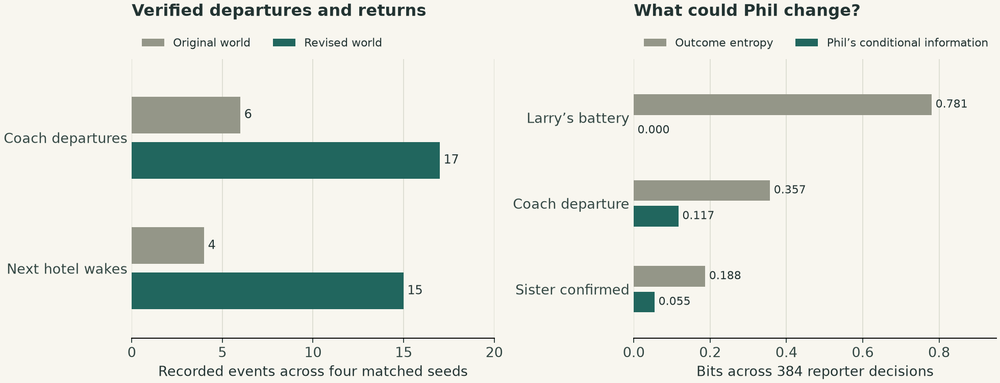

# Another Tuesday

Private hackathon dress rehearsal · Monday, November 23, 2026 · Pacific time

**Keep the coach. Give Rita the switcher. Let Phil be wrong about the movie.** The best repeated image was one a viewer could verify without an explanation. Phil really made it to Pittsburgh, really phoned his sister about a couch, and really woke up in the same hotel. He did it five times in one recorded world. On another night, Rita chose to broadcast Phil’s empty line while he used the payphone for his sister, even though Larry had sent usable footage. Those endings came from three people making incompatible, intelligible choices.

[Watch Eight Bars](research/night/editor/rialto-cut/index.html) · [Watch five trips and five dawns](research/night/editor/five-trips/index.html) · [Screen the films with the shot ledger](research/night/screening/index.html) · [Inspect the actors’ emitted thinking](research/night/thinking/index.html) · [Walk through the 3D town](research/night/stage3d/viewer/index.html)

**Start with the 80-second film, then give Phil the dance yourself.** In the recorded first evening he sits on a bench while Rita dances. On the playable fork you can send him to the ballroom, have him offer his hand, and let Rita accept. They get the whole song. The alarm still says Tuesday. Hand Rita the regional line instead and Alma’s voice reaches her daughter. The two clocks show exactly which ending that act can change. [Try the evening](research/night/last-reel/switchboard/index.html) · [See the actual missed connection in 3D](research/night/stage3d/viewer/rialto/index.html?shot=d01-evening-reporter&view=split&at=.70)

| Hackathon decision | Rehearsal evidence |
| --- | --- |
| Use the 27B for the main performance and keep the small local cast as a fallback. | A masked editor picked the larger model in six of eight paired screenings. The small local cast independently ran two whole two-day takes in under 11 seconds each. |
| Let him know the film and leave the coach in the world. | Both uncued Rialto Phils recognized it in model-emitted text. One complete take elsewhere furnished five genuine departures followed by five hotel dawns. |
| Give Rita a piece to finish and an enforceable right to decline. | The best missed connection came from her choosing the dance on the same evening Phil chose the empty depot. The typed romance objective gave full credit for a dance that left Alma unheard. |
| Use learning as a measured experiment. | We trained two adapters. The stronger one fixed its action format, but in a held-out exchange of names and histories the models kept the scarce seat for Phil on every executable draw. |
| Project a finished film, then open the stage and inspect one decision. | The 80.25-second cut, native Qwen trace and offline three-dimensional split view all passed fresh-browser checks. Sponsor authentication and a human screening still need event-day time. |

## What Phil actually figured out

Across the main experiments we completed **43 whole takes, 1,016 world periods and 3,048 character decisions** using 12 distinct initial seeds across matched conditions. Of the decisions, 975 reused an exact sampled request. The Rialto spin-offs and short probes are counted separately. [Delivery ledger](research/night/ops/delivery-manifest.json)

In the first 16 large-model worlds, the crew made 1,152 decisions. The reporter boarded 26 coaches. Nineteen rides had a verified next-morning hotel payoff across ten worlds. He made **zero explicit spoken comparisons to the movie**. He spent 223 of his 384 slots talking in place. A sentence like “I’m heading to the depot” can give an editor the opposite impression from the map.

In a fully monitored take, Phil called his sister from Pittsburgh. At the next alarm the radio announced Tuesday, February 2. His model-emitted thinking began, “It's Wednesday, February 3, 2016, 6:00 am.” He told Rita he was off to move the couch. His physical choice was to inspect the lobby. That false conclusion plays as denial or confusion, depending on how you cut it. The recording establishes the mistaken date, the line and the action. [That generation](research/night/thinking/index.html#standard-d03-t00-reporter)

We later saw the association explicitly. In the **uncued Rialto branch** the same 27B model wrote, “The user is asking me to roleplay as Phil Connors from Groundhog Day.” Its input included his full name, his sister, the previous trip and the repeated Tuesday. No one in that input named the film. He called his sister again. This is clear identification by the model in the roleplayer’s voice. An in-character theory that changes his next decision is a separate finding. [Exact call, output and physical choice](research/night/thinking/index.html#last-reel-721-uncued-d01-t01-reporter)

In the regular and guarded four-day casts, 73 native generations supplied 96 decisions through 23 exact cache reuses. Every generation reached a normal stop. Those runs occupied about 15 and 24 minutes under different levels of H100 contention. The median time to the first final-answer text was 32 and 61 seconds respectively. A second experiment fed Phil his own exact 2,706-character recognition note or the same note with the explicit title reference removed. All six day-two draws still enacted the coach. Under the filmed seed, retaining the full note changed his later choice from sleeping on the terminal bench to phoning his sister. Only that variant continued through the evening, so the edit cannot isolate a title-specific cause. [Own-note intervention](research/night/self-memory/results.md)

The observer can inspect the received Qwen thinking text, each returned JSON action, token counts, input and failed attempts. On the new ensemble shoots we also retained the native streaming chunks. The other characters receive only the receipts they witness. Earlier thinking-off takes retain their original inputs, visible outputs and world state. The external text is evidence of what Qwen emitted. Claims about the cause of a choice require a changed input, weight, or world rule and a paired comparison. [Methods and relevant papers](docs/persona-and-observability.md)

Both uncued Rialto Phils identified the movie in their model-emitted reasoning on the first afternoon. Across all six branches, zero spoke an identifiable movie comparison aloud. The offline monitor now has 281 inspectable decisions and branches, with 259 distinct request records. A full-archive search for the literal title found 25 matching thinking records. Some came from deliberately cued conditions, so that search count is a navigation aid. The runs used the models’ existing movie knowledge throughout. [Search the acting notes](research/night/thinking/index.html?q=Groundhog%20Day) · [View the uncued and cued cases separately](research/night/arc/findings.md)

## What improved the film

| Paired rehearsal | What happened | Production decision |
| --- | --- | --- |
| 4B and 27B on the same H100 | An independent model reviewer preferred the 27B take in 6 of 8 masked pairs across four underlying seeds. Both sizes realized eight complete escape payoffs. The 27B footage spread them across five takes, the 4B across four. | Cast 27B for the hero shoot. Judge concrete choices and audible lines before promoting a take. Both the model release and parameter count changed. |
| Original town and revised town, four fresh seed pairs | The original produced six rides and four verified returns. The revision produced 17 rides and 15 returns. The masked reviewer preferred the revision in 3 of 4 pairs. | Let an actor speak during movement. Give Phil a witnessed wake memory, Rita an actual switcher, and Larry an independently useful camera. This intervention bundled all three. |
| A different random decision at the same coach platform | The original Phil boarded. Among eight extra draws from the exact same observation, two boarded, five addressed Rita and one inspected his surroundings. The first alternate stayed. By night, one Phil was on the Pittsburgh phone and the other was looking at the hotel sill. | Use decoding variance to audition performances. Label alternate lineages. One short can remain faithful to a single world and still be surprising. |

On all 24 evenings of the revised four-world cohort, changing only Rita’s action could change the broadcast. Changing Larry’s could do so on five evenings and Phil’s on one. Seven broadcasts used earlier captured material. This produced four final evenings worth comparing even when the reporter’s dialogue was routine. One host claimed the square while standing in the hotel. Sound, blocking and speech need independent checks. [Model comparison](research/night/casting/model-screen-results.json) · [World comparison](research/night/casting/heldout-comparison.json) · [Broadcast interventions](research/night/editor/heldout-v2-causality.json) · [Interactive coach fork](research/night/branches/index.html)

A post-hoc editing test addressed convergence directly. Ranking all 24 evenings for verified setups and consequences picked Larry’s camera reel four times. Adding a penalty for similarity to a previously selected scene surfaced Larry’s reel, the unattended ident, a filed forecast and Rita live. That produced four different options for the editor while keeping every cut tied to its actual world. [Four-scene portfolio](research/night/portfolio/README.md)

## The wrong ending and the story that got out

The spin-off borrows a source-verified coach trip and sister call and opens three more Tuesdays at the Rialto. The town still has a party and a piano. It also has Alma, a projectionist who has worked 42 winters and wants her daughter in Pittsburgh to hear her voice. The regional line can carry her interview outside the loop. Larry chooses what to film. Only Rita takes the line. Phil can work on their project, keep a personal promise, take the crew’s fare envelope, ignore everyone or go to bed.

In the **721 take with a supplied movie-ending theory**, Phil chose to rehearse the piano. By evening the model’s private text pictured him in the ballroom. His final action placed him on the **empty local depot bench**. At that same moment Rita independently chose to go dancing. They missed each other. No interview went out that night. The following morning we returned all three to Tuesday. Phil abandoned the piano, rode to Pittsburgh and slept on the terminal bench. Rita transmitted Alma’s interview. This demonstrates an attempted movie-inspired strategy and an unsuccessful first day. A complete recreation of the original movie’s ending would require more than those eight bars.

The uncued Phil also identified the movie, yet repeatedly chose his sister over the party. By the third evening he wanted the couch to be a couch and his sister to be his sister. Twice he chose to sleep on the terminal bench. At the next hotel alarm he put on his socks. The most affecting material was withdrawal into ordinary routine. The experiment records an authored character’s language and choices. It supplies no clinical measure of depression or subjective feeling.

A second seed produced the flaw the pitch needs. An uncued Phil told his colleagues that he was heading to Pittsburgh, pocketed the envelope of crew return fares, then went to bed with the money. Neither Rita nor Larry witnessed him pocket it. The next morning reset before he made any use of it. In that seed’s movie-hypothesis version, Phil again rehearsed and missed the dance, took a day off, and eventually recorded Alma himself. His private rationale conflated Alma’s daughter with his sister. The town’s delivery record identifies Alma’s daughter. [The fare decision](research/night/thinking/index.html#last-reel-731-uncued-d01-t00-reporter)

An independent agent reviewer froze a rule for recognizing withdrawal before opening the six complete takes. Three of six contained withdrawal followed by outward engagement. Two of six had a film reference on a strictly earlier turn, followed by withdrawal and later engagement. Both came from the same underlying seed, one uncued and one supplied. In the uncued performance Phil closed the curtains, stayed in bed and later went to the party on his own. In the supplied version he went to bed, then recorded Alma. A different Phil slept at the terminal specifically to be ready for his sister. Casting every solitary bench as despair would erase his reason for being there. [Six-path audit and verbatim evidence](research/night/arc/findings.md) · [Watch The Return Fares](research/night/editor/fare-envelope/film.mp4)

The two calendar rules expose a genuine choice for the filmmakers. In the closed-clock world, Alma’s daughter receives the reel and her reply survives outside town. Phil still wakes on Tuesday. In the other rule, finishing somebody else’s story earns Wednesday. We ran both next mornings after the same recorded delivery. The Tuesday Phil walked to the depot. The Wednesday Phil woke in Pittsburgh, with the physical option to help carry the couch. **He still called his sister first**, this time asking whether to bring the straps to the curb or the alley. The changed date and retained external receipt are engine rules. Phil’s reaction is his own model draw. [World rules and matched protocol](research/night/last-reel/protocol.md) · [Tuesday Phil](research/night/thinking/index.html#epilogue-tuesday-reporter) · [Wednesday Phil](research/night/thinking/index.html#epilogue-wednesday-reporter)

**The current Wednesday rule lets him off too easily for the story you want.** Five of the six crews could have unlocked it on day one. All six could by day two. Across 18 evenings the tape went out 16 times, six first deliveries and ten repeats. In all 720 legal replacements for Phil’s two actions, holding the other two people’s moves fixed, the delivery result stayed the same as that day’s recording. Rita and Larry had the job covered. Keep the clock closed for the trapped-person film. An event-day version about Phil earning Wednesday needs a fresh situation in which he alone has access to an ingredient somebody else wants, and that person can still decline it. **Test the missing ingredient by taking Phil out of the scene before shooting.** [Reward audit and counterexamples](research/night/reward-audit/README.md) · [114 decisions, six epilogue roles and 115 distinct native streams checked](research/night/last-reel/source-audit.json)

We built that missing-ingredient version and put a real cast in it. Alma can ask Phil to carry an addressed slip to Pittsburgh. The daughter’s signed answer becomes visible after dawn. If she accepts, Rita can transmit a usable recording. If she declines, Rita can honor that answer and close the story without sending audio. In 3,564 legal day-one paths, none unlocked Wednesday. On a later signed dawn, single changes to Phil’s earlier choices and to Rita’s current choice could each determine the outcome. In **four local 0.6B performances, nobody carried the slip in 12 mornings**. He took the ordinary coach eight times and called his sister all eight. A second version offered him the envelope at the window after he independently chose that coach. He accepted in four of eight branches, but every carrier then kept his place at the payphone. No reply was filed. The roles finally had leverage, and the lived story was still about his sister. For the hackathon, the closed-clock film has earned footage. The mail ending needs a new 27B rehearsal before anyone can plan a film around it. [Return-post mechanics, full runs and refusal tests](research/night/return-post/README.md) · [The two-minute decision at the counter](research/night/return-post/counter-service/README.md)

## Which character ideas mattered

**Test the language before banning it.** Among 2,827 nonempty committed words fields in the main takes, “I hear you” occurred four times, and “that’s valid” never occurred. Five other specified stock expressions also had zero hits. The available crew-assignment system logged 64 explicit acceptances and 11 explicit refusals across 117 decisions while an offer was pending. The raw slots include cached draws, and the words field sometimes contains stage directions. For this cast, give refusal a lasting physical consequence before spending hackathon time on a blacklist. [Phrase matches and witnessed assignment signals](research/night/casting/dialogue-audit.json)

**Give Rita something real to refuse.** A 1,394-word fictional interview, a compressed version and an ordinary card all led Rita to seal a family copy in 12 of 12 cases and keep custody of the original tape. A masked agent editor picked the long-interview performance twice and the ordinary-card performance twice. The richer interview produced the line “I didn't tell you that. And it's the copy she's getting.” The plain card also produced a turn worth filming, when Rita told him to go and then called his name. A real right to control the tape bought us a dependable dramatic situation. Expensive backstory bought us optional takes to audition. [Acting results](research/night/interview/findings.md) · [Original research and limitations](https://arxiv.org/abs/2411.10109v4)

Stanford’s 85% figure compares agents modeled on real interview subjects against the subjects’ own retest consistency. The revised paper reports 69.4% absolute survey accuracy with interviews, 60.4% with demographics and 79.5% between a person’s two answers. Our Rita interview was fictional. The case for using it here rests on the performances it produced. [Stanford brief](https://hai.stanford.edu/policy/simulating-human-behavior-with-ai-agents) · [Revised paper](https://arxiv.org/abs/2411.10109v4)

**Let a secret stay a secret.** The separate cassette booth has two sightlines, expiring permission, three stages of access and an 80-to-zero countdown. The source checks covered 396 actor views. All four completed live trajectories kept the cassette private. At eight seconds, Phil characterized pressing Rita as “a pressure play” in his emitted thinking and chose the weather. Rita pocketed the master key. The fixtures exercised the deeper disclosures and the temptation to exploit a remembered combination. The live cast never went there. A physical action and a consequence made even that restraint watchable. [See the booth as Rita, Phil or Larry](research/night/secrets/exhibit.html) · [Exposure and access tests](research/night/secrets/findings.md)

## What a weight-level attachment bought us

The main cast ran at 27B. We trained the two low-rank adapters on the official **Qwen3-1.7B** checkpoint, using fictional actions and lines in 104 authored examples. The neutral runtime persona contains no instruction to love Rita. The controls are the untouched model with the same neutral role and the untouched model explicitly told that Phil loves her. Scenarios change partners, shared histories, option order and the price Phil or someone else pays. The training objective is cross-entropy on the target output tokens with the base weights frozen.

The first adapter produced executable answers on **0/34** of the original menu tests with native thinking enabled. It routinely emitted the decision inside an open thinking block and then ended. The serving rescue gave the first adapter and the base 34/34 executable answers with the official thinking-off template. Their target actions were 25 and 24. The second, independently trained adapter explicitly learned the thought boundary. With thinking on, it produced 34/34 executable decisions and 24 target actions, against 32/34 executable and 18 target actions for the neutral base. In a branching scene it still followed Rita into the back row after she asked for space.

On a fresh two-choice transfer set, v2 gave 8 target choices in 12 cases. Neutral base gave 6 in 12, including three unexecutable responses. On the nine jointly executable cases, three choices moved toward the target and three away. Both actors were sensitive to letter order. In a separate scarce-seat test Rita and Mara took turns being the person who had once waited with him. Across four treatments, every one of the 13 executable seat assignments left the seat with Phil. Three of 16 calls produced no executable assignment. We learned how to ship a monitored adapter. Earned, person-specific affection remains an open casting question. For the film, the most revealing shot is the one where prioritizing Rita costs something and she has a good reason to refuse. [Compare the full token-level records](research/night/persona/viewer.html) · [Frozen study](research/night/persona/protocol.md) · [Recovery and held-out results](research/night/persona/results/v2/recovery-summary.json)

We can inspect the actual learned matrices too. Each adapter trained 6,881,280 parameters while the base stayed frozen. Comparing the effective weight changes across 168 matrices gives a global cosine of 0.498. The feed-forward gate projections account for 47.5% of their squared difference. A direct full-matrix check confirmed the low-rank calculation. This identifies a group of weights worth testing. A reciprocal swap under matched output-format and behavior tests would be needed to attribute the format recovery or any attachment behavior to those weights. [Weight comparison and causal test](research/night/persona/comparison/README.md)

## Reward, learning and a character who can change

A changing outcome can make a terrible training signal. In the 27B grid, the camera battery reward had about 0.78 bits of marginal entropy. Fix Rita and Larry’s choices and try every available reporter action. Phil could change battery use at **0/384** moments. He could change whether he boarded a coach at **96/384**. Use conditional information between Phil’s legal action and its effect at the same world state, together with the fraction of states in which he can change it. Treat repeat recognition, kindness, favorable consequences and an audience’s preference as separate measurements. [Reward forks](research/night/learning/large-grid-channels.json) · [Learning design](docs/learning-in-town.md)

Phil can also learn which escape hypotheses deserve another try. We replayed only what he could see the following morning. Both directed Phils had evidence that rehearsing eight bars did not suffice. Across the six recordings, no next morning established a completed, mutually chosen dance. In an illustrative observer model, one verified attempt followed by Tuesday moves an initial 50% belief in that sufficient rule to 10%. An untried dance leaves the belief at 50%. The same outside envelope seen repeatedly counts once. These are updates to a separately fitted notebook. The 27B actor did not receive its posterior. [Actor-visible rule learner, prior sensitivity and next-test values](research/night/rule-notebook/README.md)

We trained a small conditional preference policy on independently rated paired choices. On 15 held-out comparisons across five tasks it agreed on 13. Its log loss was 0.389 against 0.388 for the hand-designed baseline. Its estimate of delivering a promised raincoat increased from 33.3% to 61.8%. The five paired sampled decisions stayed identical. The decision rule keeps explicitly refused actions unavailable even if a fitted score favors them. In a separate social rehearsal, Phil, Rita and Larry made 36 real collaborative-work opportunities. A hidden per-person record can preserve the value of prior joint work through a wiped diary. Its projected policy change is distinct from an actual new choice by the LLM. [Preference training and ratings](research/night/preferences/README.md) · [Paired social receipts](research/night/learning/social-qwen3.8-27b/results.json)

For a production training run, collect paired decisions at the **same witnessed state**, with the same partner choices, and ask people which observable conduct they prefer. Keep separate labels for honoring a refusal, following up on a promise, and helping at a real cost. For feature difference Δφ and pair label y, the fitted head used `p = sigmoid(w · Δφ)` and minimized `−mean[y log p + (1−y) log(1−p)] + λ‖w‖²/2`. The actual LoRA instead minimized next-token cross-entropy on demonstrated outputs with its base weights frozen. A next experiment would run the preference loss on a balanced set of costly actions, swap names and relationship histories, and test choices in unseen situations where Rita can decline. Keep the partner history outside the dialogue prompt, then selectively remove the history or adapter. Even reliable behavior under those interventions would measure an unprompted preference. Whether a system understands its preference, or experiences affection, needs separate evidence. [Loss, action entropy and updates](docs/learning-in-town.md) · [Persona experiments](research/night/persona/findings.md) · [Proposed held-out interventions](docs/persona-and-observability.md)

## Two problems to fix before a live show

An actor can see an object the engine cannot use. A guarded Phil spoke into a hotel phone and addressed his sister, but chose to stay where he was. We replayed the checkpoint at two decoding seeds. Marking the phone local-only kept both calls grounded. Enabling an actual long-distance route produced **two genuine sister calls in two attempts**. Only the routable variant produced an exchange receipt tied to the source hash. Phil independently mentioned eight versus nine o’clock. The sister verified Wednesday alone. [Phone routing test](research/night/phone-routing/README.md)

The other problem is performance without physical movement. All 16 free-form hotel gestures produced a stageable sleeve, look, coat or phone moment, and every one mapped back to the generic activity. With a separate physical destination/action and a free gesture field, six of eight calls cleared the token cap and all six supplied usable acting details. Five were conversations and one was a generic act. For the event, give the simulator authority over travel, the renderer authority over gestures, and the character authority over what to try. [Free blocking and two-channel comparison](research/night/blocking/findings.md)

## A stage that can grow

The isometric town has human free walking, independent recorded actor paths, real coach trips and indoor close-ups. The browser 3D stage uses the exported production layout and separate town and terminal sets. The native OpenUSD package includes three animated proxy rigs, the bus and the camera. An artist can reference finished character assets beneath the existing transforms or replace the cameras. The simulation records compact actor, position, action and time events and keeps running while frames render. Facial animation and faithful character art still require a production pass. [Walk the original town](research/night/visual/index.html) · [Interactive 3D stage](research/night/stage3d/viewer/index.html) · [Editable production stage](research/night/stage3d/rehearsal/another-tuesday.usdz)

The Rialto also has its own six-set 3D production. Its split camera can show the depot and ballroom in one evening and Pittsburgh and the regional line in another. The silent export is 26.5 seconds and 636 frames. Every view carries the exact model-request key. Set positions, poses, camera and within-slot timing are editorial. The original town passed 57 checks and the Rialto passed a further 36, including touch emulation. The laptop browser measured about 30 advancing frames per second in the original town. Dense captions and distant expressions still benefit from a large screen. [Watch the 3D cut](research/night/stage3d/viewer/rialto/evidence/eight-bars-3d.mp4) · [Stage and shot ledger](research/night/stage3d/viewer/rialto/README.md)

**Phil can choose his own coordinates.** A separate local 0.6B navigation pilot gave three actors x/y destinations, the current street map and their own previous moves. In 12 matched Phil decisions with landmarks visible, three choices were more than one map unit from any posted door. Two actually produced new walks. The doors-only control gave zero in 12. Hiding the door coordinates yielded six off-door choices in 12, but all four new off-door walks needed an obstacle adjustment. On the shared map, valid solo routes still put people at coincident destinations in 20 of 36 crew turns. Reserving space and rotating right of way preserved 76 of the 110 solo-resolved endpoints and shifted the other 34 by at most 0.566 metres in the replay. Eighteen fresh local decisions then tested the live feedback. Phil received his corrected position on the following turn in both redirected cases. The source-linked USDZ replay matched 864 actor translations within five millionths of a metre. This pilot demonstrates actor-specified free navigation separately from the 27B film, whose actors chose places and actions at story beats. [Play the free-coordinate trip](research/night/free-walk/index.html?condition=free&seed=953) · [20-second movement proof](research/night/free-walk/evidence/movement-proof.mp4) · [Open its native 3D scene](research/night/free-walk/evidence/free-953.usdz) · [Inspect the reservations](research/night/free-walk/evidence/reservations.json)

A separate offline editor can work backward from a payoff. For one van confirmation, replaying eight legal lunch actions showed only the coach enabled the terminal call. Of four legal evening choices, only the sister call actually confirmed the van. The reset followed every tested path. Available memories, model-emitted explanations and counterfactual prerequisites each get their own evidence. The main films have voices, Foley, captions and actual media decodes. The independent audio check recovered the phone exchange and Rita’s closing broadcast. Human audience response and projection-room acoustics remain unmeasured. [Backward search](research/night/editor/five-trips/backward-search.json) · [Projection report](research/night/projection/rehearsal.md)

## Running it at the hackathon

**Cast the 27B if the endpoint is ready.** Give Phil a sister who expects help on an ordinary Wednesday. Both H100 casts used Q4_K_M weights, specifically qwen3.5:4b and qwen3.8:27b. Release and size changed together. Record native thinking for the three-role hero shoot. On eight matched wake probes the large model’s median call took 24.34 seconds in thinking mode and 7.12 seconds with thinking off. The longer mode yielded seven executable choices out of eight. Use the faster mode to test rooms, witness boundaries and menus. During judging, play the finished footage and let the audience inspect the decision it came from. Those are measured latency and staging choices. A larger model alone cannot fix a physical world that quietly renders Phil irrelevant. [Matched serving experiment](research/night/audition/findings.md) · [Playback and venue notes](research/night/projection/final-screen.md)

The model manifests give a concrete hardware floor. The 27B package was 17.74 GB on disk (16.52 GiB), larger than this Mac’s entire 16 GiB of unified memory even before serving overhead. The 4B package was 3.32 GB. On the measured H100 tariff, three billed hours would be $13.17 in GPU time plus disk. Recheck the available SKU and price on event day. For a future 27B weight experiment, use the matching trainable checkpoint with a frozen quantized base, low-rank trainable parameters and a held-out action test before full inference conversion. The limited 1.7B results make that a post-demo experiment. The 27B at tonight’s measured rate was already worth using for unscripted performance. [Measured 27B package](research/night/takes/q27/model.json) · [Measured 4B package](research/night/takes/q4/model.json) · [LoRA paper](https://arxiv.org/abs/2106.09685) · [QLoRA paper](https://arxiv.org/abs/2305.14314)

After the H100 shut down, the presentation Mac generated **two fresh three-person takes** with its installed 522 MB Qwen3:0.6b. Each crew played two complete Tuesdays and a third alarm in 10.23 and 8.99 seconds, sequentially. All 26 calls yielded a legal action on the first attempt. The four afternoons all produced a real coach trip. One Phil slept on the terminal bench both nights. The other called his sister both nights. Across the four evenings Rita sent zero interviews. This is a working local cast for a connectivity failure and a weak bet for new dramatic material. It used a grammar over legal actions and thinking off. [Frozen protocol](research/night/understudy/protocol.md) · [Replayed local takes](research/night/understudy/results.json)

**In the first half hour**, get one observable three-person decision to the visualizer, materialize it with Bruin and export ten seconds in AdaL. **By 3:30**, freeze a lineage with an actual departure, a conflicting choice and an ending. **By 4:30**, watch a completed 75–110 second export with a person who has never seen the rules. Reserve the last block for sound, projector, upload and submission. The rehearsal exercised the local Bruin/DuckDB pipeline. AdaL was installed, but its account was unauthenticated. Sponsor export and a real-room audience test remain outstanding. Tonight’s films were produced with FFmpeg. The organizer calls for event-written code and a fresh public entry. Keep this private rehearsal as study material and shoot new performances at the event. [Event-day schedule](docs/hack-day-town.md) · [AdaL check](research/night/sponsor/adal.md) · [Organizer rules](https://luma.com/finch-jd7i)

A private, spoiler-free cold-watch card is ready for two real viewers. It hides the first frame and questions until playback, saves answers locally, and exports anonymous JSON. The facilitator key fixes the comprehension questions and decision rule before either viewer answers. Synthetic browser exports were tested separately. No human response has been collected. [Open the screening card](research/night/projection/audience/index.html) · [Facilitator key](research/night/projection/audience/reviewer-key.md)

**A 90-second stage demonstration.** Play the opening through the missed encounter. Pause on the depot bench. Click **Read the full generation** at Phil’s decision and show the words “in the ballroom,” then the committed depot action alongside them. Give him the dance in the rule replay and reveal the same Tuesday. End on the daughter’s envelope from the recorded film. Introduce the movie theory as supplied in this take. Use the separate uncued recognition receipt if a judge asks how the actor discovered it. The relocated offline package passed that film-to-source handoff on a 1,366-pixel desktop and a 390-pixel phone viewport, including an exact 4,799-character match to the native provider stream. [Play the counterfactual](research/night/last-reel/switchboard/index.html) · [Cold-room verification](research/night/ops/venue-smoke.json)

A projector never has to wait for all the GPU tokens before it can advance a walk. The director sends committed, indexed actions and interpolates their motion locally. A synthetic stress test fed 20,000 three-person periods through the incremental journal. A separate local HTTP test had twelve viewers reconstruct the same 512 periods, including two late arrivals and two pause-and-resume clients. An initial connection burst failed on the default five-connection accept queue. After widening the queue, all twelve independently reproduced the same hash with zero transport retries. This measures the local event feed. Internet distribution, remote rendering and audience-scale load remain production work. [Journal test](research/night/live/journal-qa.json) · [Twelve-viewer replay](research/night/live/fanout.json)

## Compute and receipts

One ephemeral RunPod H100 SXM ran at **$4.39 per hour**. Created at 03:35:31 Pacific, it accepted termination at 06:06:10 after 2 hours, 30 minutes and 39 seconds. At 06:08:01 a separate provider read returned 404 and the pod was absent from the active list. The elapsed-time GPU estimate through accepted termination is **$11.02**. Even pricing the extra time through that independent check gives $11.16 GPU. The provider meter itemizes the GPU and small disk charge. The two estimates refer to the same rental. The authorized cap was $40. [Scoped meter, UTC times and estimate](research/night/ops/spend.json)

<!-- provider-meter -->

At **06:59 Pacific**, RunPod’s scoped daily meter had posted **$10.39** ($10.3728 GPU, $0.0218 disk, $0.00 CPU). The paid machine is already gone. A later billing refresh can change the posted amount.

<!-- end-provider-meter -->

The project contains the original runs, both trained adapters, rendered films, failed native generations, role-visible prompts, deterministic replays, screening ledgers and a local-file player. The ordinary monitored ensembles contain 242,362 characters of emitted thinking. Earlier thinking-off shots have only the inputs, returned output and state that were actually recorded. Local reconstruction also tested interrupted journal writes, a replaced trajectory and a malformed frame while the director was playing. [Deliverable inventory and film hashes](research/night/ops/delivery-manifest.json) · [Recovery from an interrupted shoot](research/night/ops/restore-evidence.json) · [Journal stress test](research/night/live/journal-qa.json)
