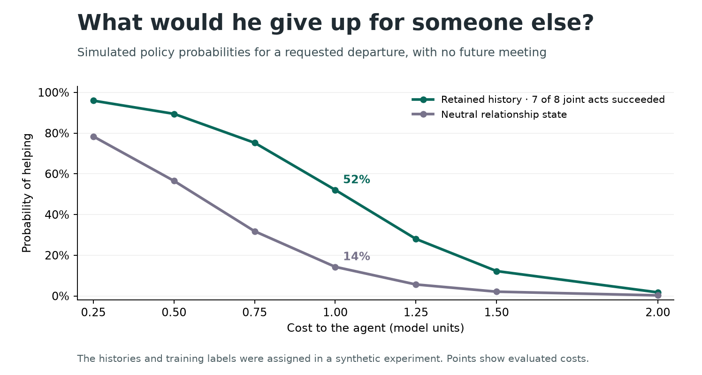

# What survives when the diary is gone?

The most revealing scene is a last meeting. She asks for something that will take her away, he will never meet her again, and helping costs him something he wanted. A character who recognizes her can make that choice. So can a character whose past has altered the price he is willing to pay, even after he has lost the facts of their acquaintance. The second case is the one I would try to film.

There are two distinct things to learn. **Consideration** generalizes across people. It includes asking once when someone’s wishes are unclear, remembering an undertaking while it is live, and stopping when the answer is no. **Attachment** is personal. Through shared experience, the agent may come to spend more of its limited resources on one person’s freely chosen project. This distinction gives the film an interesting failure mode. He might know her habits perfectly and still behave selfishly. He might also become considerate and develop no particular preference for her.

## A learning algorithm small enough to run during the event

**Make Tomas a composite agent.** A frozen language model perceives his scene and supplies dialogue. A small trained head chooses among physically legal actions. An identity-scoped record tracks shared experience. The actor’s prompt can mention the person he currently sees and what they just said. It contains no attachment score, relationship label, private objective for her, or instruction to love anyone. When the head chooses an act, the language model sees the act and the evidence currently available to him. Let it speak briefly or remain silent. Log a subsequent explanation as speech. The policy distribution is the record of how the choice was made.

1. **Generate genuinely different decisions from the same situation.** Freeze the partner’s policy while comparing Tomas’s choices. From a checkpoint, try two legal actions with matched randomness. Let the other character accept, decline, change her mind or pursue her own work. Resolve one or two ticks of consequences. Include opportunities where leaving her alone is best and others where silence would break a promise. Change costs and deadlines. Set aside whole worlds and unfamiliar tasks for evaluation.
2. **Learn what consideration looks like.** In 30–60 event-day comparisons as a starting budget, two team members can rank short paired segments with names, romance cues and attractive prose hidden. Show what each person asked for, what choosing it cost, and what actually happened. Permit a tie or an “insufficient evidence” label. Fit four to six weights on features such as requested progress, a resolved uncertainty, a kept commitment, renewed pressure after refusal and opportunity cost. The human rubric defines these values. It should reward the very same actions for the keeper and the baker under matched conditions. Compare to a small hand-written rule as well as the frozen model.
3. **Predict the consequences at execution time.** The offline labeler can inspect eventual outcomes. The online head only gets observations available at that time. Estimate candidate features from grounded preconditions and a small, frozen partner-response model or short forks conditioned on the actor’s belief about the partner. Private goals, undisclosed facts and the actual future action stay hidden. Her clear refusal can immediately close an offer. An ambiguous answer leaves the option to ask once or proceed with his own task.
4. **Let individual history modify only a bounded part of valuation.** For each recognizable partner, start with the same prior. After an independently accepted, distinct joint activity, update whether it reached its shared objective. Deduplicate by project and situation across repeated Tuesdays. A declined invitation produces no trial and no relationship penalty. Matched opportunities with other people help separate time spent together, gratitude and selective attachment. Cap the influence of the relationship term. A character who wants space has no active invitation for that term to amplify.
5. **Train between takes and log precisely when something was learned.** Fit the general head on potential choices outside the filmed lineage and freeze its starting version. Within a take, the relationship record can update only from that take’s actual events. For a *personal growth* claim within a film, also update a bounded personal residual from completed, observed feedback between days, archive each version, and compare it with its frozen opening copy. A pretrained considerate head already working on day one supports a different claim. The team can ship the former as a later experiment if feedback is too sparse.

Short-trajectory comparisons are an established way to fit reward models. The choices above about whose preferences count and what survives forgetting belong to this fictional world. [Christiano et al., *Deep Reinforcement Learning from Human Preferences*](https://arxiv.org/abs/1706.03741) · [Rabinowitz et al., *Machine Theory of Mind*](https://proceedings.mlr.press/v80/rabinowitz18a.html)

### The loss and action rule

Let F₁ and F₂ be the summed consequence features for candidate segments from the same checkpoint. Let y be 1 if the first segment is preferred, 0 if the second is preferred and ½ for an explicit tie. Omit comparisons with insufficient evidence. Fit a ridge-regularized Bradley–Terry model.

    p = sigmoid(w · (F₁ − F₂))
    L(w) = mean[−y log p − (1−y) log(1−p)] + (λ/2) ||w||²

A simple personal state uses s successes and f failures from distinct, mutually chosen joint projects. A Beta(2,2) prior starts everybody at neutral. The particular mapping below is an authored inductive bias, and can be varied in an ablation.

    z(person) = max(0, 2(2+s)/(4+s+f) − 1)
    Q(a) = w · E[F | current observations, a]
           + β z(person) E[progress on their currently requested project | observations, a]
    π(a | observations) ∝ π₀(a | observations) exp(Q(a)/τ), over legal actions only

π₀ is a frozen plausible action prior with support for every legal option. The policy trades expected value against τ times its KL divergence from that prior. A uniform prior suffices for a first instrument. Inspect the cost curve before choosing τ or β. Very low temperature makes decisions brittle. Excessive relationship weight makes him abandon everything else. Never select those parameters by which one makes the baker his favorite. Treat simultaneous requests as competing claims on a limited resource. Evaluate favoritism that breaks commitments to somebody else.

This is a lightweight contextual decision policy with preference learning and an experience-dependent state. It can be trained on CPU. It handles short consequences directly. For delayed promises, assign a unique commitment ID and attach the eventual kept/broken receipt to the originating segment. Censor unresolved promises at the run cap. Only consider longer-horizon RL once there are enough independent opportunities and reliable consequences. Hundreds of adjacent words in one transcript still represent a single action.

A more ambitious version puts the residual **inside the acting model**. Freeze the language weights and train a small action-logit adapter on the same paired segments or legal-action targets. Route a learned partner embedding from the perception system into this adapter before the action distribution is sampled. Keep the dialogue adapter separate and log the pre-action logits. Archive the exact base revision, adapter and per-person state. This buys a weight-level intervention and a precise erase-and-replay test. It also requires a differentiable local model and enough new scenarios to beat a small head on held-out behavior. Neither an assigned “romantic persona” vector nor a name-specific reward establishes that the relationship developed during play. [Rafailov et al., *Direct Preference Optimization*](https://arxiv.org/abs/2305.18290)

For a concrete within-lifetime update, keep a tiny personal consequence predictor beside the population head. After he offers assistance, the engine records an observable acceptance, decline or counteroffer. Train a three-way softmax on his pre-offer features with cross-entropy against that response. After an accepted act resolves, train a separate binary head on whether the promised work actually finished. Include deadlines, available equipment and prior explicit requests among the features. Missing feedback contributes no label. These predictions feed the expectation in Q. As a result he can learn *when* an offer is welcome and when it can actually help, even though the general value assigned to keeping a promise stays fixed. His own decisions determine which responses he ever sees, so save randomized rehearsal forks for calibration and score on unseen tasks. In the film, compare his initial and final predictors on the same checkpoint. Four mornings with no real invitations supply no evidence of improvement.

## Reward entropy and how to spend the labels

A binary reward that succeeds on fraction p of trials has H(R) = −p log₂ p − (1−p) log₂(1−p). In the first local drawer experiment the observed key-collection reward was always zero, giving **0 sample bits**. The baker boarded in 11/12 intact cases, giving **0.414 sample bits** for boarding. A balanced independent coin would provide a whole bit yet teach the character nothing about which act helps. These small-sample entropies describe the measured batch only.

Record four quantities separately.

| Quantity | What it answers | How to use it |
| --- | --- | --- |
| H(R) within a fixed, defined outcome or reward binning | Did this signal vary? | Report counts and binning. Look for all-zero progress or all-positive approval. |
| H(R given S,A) and I(A;R given S) | How much uncertainty remains after the act? Does changing the act change reward within comparable states? | Fork legal alternatives at identical checkpoints and repeat over hidden world draws. Vary actions experimentally. Constant observed actions cannot identify a causal effect. |
| H(π) / log(number of legal actions) | Does the policy explore multiple plausible options here? | Exclude forced moves. A decisive refusal can correctly have low entropy. Explore in rehearsal and use the selected fixed policy in the canonical take. |
| H(ending), once per independent root | Did independent lives reach different outcomes? | Publish raw counts, caps and failures. Keep correlated forks in a separate table. Ending diversity stays an editorial diagnostic. |

If speech is lovely but reward never moves, inspect the chain of **opportunity → invitation → acceptance → cost → consequence**. The missing transition identifies a repair. If all actions receive the same value because the world never distinguishes them, a larger model or a higher sampling temperature offers little leverage. If labels are scarce, fit several bootstrap heads. Prefer comparison pairs for which heads are individually confident and disagree. Estimate that disagreement by subtracting the mean entropy of individual predictions from the entropy of their average prediction. Balance by partner and social situation. Pairs of scenes where every head predicts ½ can be genuinely ambiguous. Never acquire training labels from the held-out test.

## The wipe experiment

At one previously unseen, costly choice, fork the diary independently from the relationship state, producing four cells. Block the drawer, evaluator feedback, summary caches and future interactions. Hold the partner’s current request and independently controlled policy fixed. Use the same action menu, price, uniforms and background world in each pair. Sweep price and plot the probability of giving up his own opportunity. Test factual recall of an arbitrary private detail in a side query and compare against the fresh-actor baseline.

- **Diary present, relationship neutral.** Can he recall the past while showing his ordinary willingness to help?
- **Diary erased, relationship retained.** Does factual recall return to baseline while a selective willingness to pay survives?
- **Both present or both erased.** These give the interaction and the ordinary baseline. Also restore personal adapters and optimizer state for a complete personal reset. The generic population policy can stay fixed across all four arms.
- **Exchange Mara’s and Kit’s history records, then swap names or visual casting separately.** A change following history across identities is evidence against a pure name or casting preference. Add a same-exposure partner, a matched stranger and a novel activity. Explicitly test her choosing departure, choosing to stay, changing her mind and refusing further help. Report unconditional rates and results conditioned on the opportunity actually occurring.

When computing paired effects, estimate uncertainty over independent world roots, with price points and branches nested within them. One divergent pair makes an excellent demonstration. It cannot estimate a population rate. Keep the film’s state description explicit about the split. He has lost conscious records accessible to the language actor and the relationship-valuing system still carries information. The actor may infer the pattern from his own behavior. His private experience is beyond what this experiment measures.

## What the synthetic training actually achieved

A five-weight head fitted on **240 simulated preference comparisons** reached log loss **0.299** on 800 new comparisons from the same synthetic generator. The uninformative prediction scored 0.693. At a fixed cost of one unit and no future meeting, the probability of assisting a requested departure rose from **14.3%** at neutral relationship state to **52.1%** under an assigned history of seven successful collaborations out of eight. The same mechanism increased help for a requested stay. The relationship term contributes exactly zero after an explicit refusal. The figures are policy probabilities, not frequencies from a filmed character. [Full synthetic parameters and cost sweep](../research/social-learning-results.json)

Those numbers validate the arithmetic. The teacher labels, opportunity costs and favorable history were constructed. The synthetic head saw exact one-step consequence features. In an island rehearsal where working alone was entirely viable, there were **zero invitations in 36 opportunities**. Every relationship remained neutral. For the follow-up in a radio booth with genuinely two-person work, see the [rehearsal record](rehearsal.md). The artistic risk is useful: if he only learns that Kit is dependable, that is the relationship this particular run earned.

