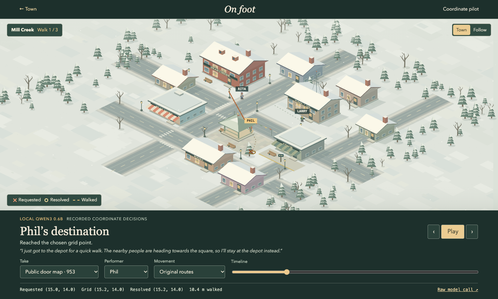

# On foot

[Watch Phil choose an off-landmark coordinate](index.html?condition=free&seed=953) · [Watch the movement proof](evidence/movement-proof.mp4) · [Open the animated native USDZ](evidence/free-953.usdz)

Phil chose **(15, 14)** in an open town with five posted venue doors. The nearest posted door was 2.40 metres away. The town quantized his request to **(15.2, 14.0)** and he walked 10.35 metres there. He stayed put on his second turn, then chose **(14, 13.5)** and walked another 1.26 metres. You can follow Rita or Larry during any of those same turns. Each sent their own pair of model-generated coordinates.

This local pilot used the installed **Qwen3 0.6B** through a loopback Ollama server. It took **128 sequential inference calls** across 15 recorded runs, about 65 seconds of measured request time and $0 in cloud spend. The navigation trials use Mill Creek’s existing geometry. The [27B character recordings](../visual/README.md) remain a separate experiment.

## What Phil chose

Four matched seeds each supplied three decisions per performer in three conditions. A fourth, explicitly prompted trial checked obstruction feedback. All conditions accepted an unrestricted numeric `x` and `y` through the same schema. The doors-only control changed the instruction. One control decision by Rita disregarded it.

An *off-landmark* proposal lies more than 1.0 metre from every posted venue door. A *new off-landmark walk* must end beyond that radius and travel more than one 0.4-metre grid cell. That second measure removes repetitions and small movements introduced by rounding. The 12 decisions in each row come from four trajectories.

| Phil’s condition | Off-landmark proposals | New off-landmark walks | Seeds with an off-landmark proposal |
| --- | ---: | ---: | ---: |
| Told to use a posted door | 0 / 12 | 0 / 12 | 0 / 4 |
| Free to go anywhere, with posted doors | 3 / 12 | 2 / 12 | 1 / 4 |
| Free to go anywhere, door coordinates removed | 6 / 12 | 4 / 12 | 4 / 4 |

The public-map result establishes that Phil sometimes selected his own non-venue waypoint. In the other three free seeds, he stayed near posted venues. Across the full three-person cast, the open-map condition produced 10 off-landmark requests in 36 decisions and five new off-landmark walks. Removing the door table yielded 30 requests and 14 walks. All four of Phil’s new off-landmark walks in that condition hit an obstacle that forced an endpoint adjustment. The map still showed the names and footprints of buildings.

Words were a weak location sensor. Seed 953 Phil said he had reached the depot when his body was 2.21 metres from its door. In the [blocked-pin calibration](index.html?condition=obstruction&seed=967), the first instruction explicitly supplied a point inside the hotel, **(5.2, 6.0)**. The resolver placed Phil at **(5.2, 4.4)**. His next model input contained that adjustment. He then chose **(15.5, 15.35)** while referring to the diner in speech. Geometry establishes what happened. The calibration establishes receipt of the correction and a subsequent legal choice. [First calibration call](runs/obstruction-967/calls/obstruction-967-t00-reporter.json) · [Following call with its observed outcome](runs/obstruction-967/calls/obstruction-967-t01-reporter.json)

## What collided and what fixed it

The model sees its own position, static public map and obstructions, crew members within four metres, and up to two of its own previous resolved walks. The three model calls run sequentially. A shared turn barrier gives each performer observations from before any of that turn’s movements. Only the movement layer can update physical positions.

The primary resolver uses the [existing town planner](../visual/world.js), a 0.4-metre grid and continuous segment tests against inflated building and bandstand rectangles. All 110 primary decisions passed independent raw-response and source-hash checks. The routes covered 130 logged segments with **zero canonical geometry violations** over 10,451 sampled positions. The polished 3D set adds furniture and modifies two building footprints across the full native stage. Eight pilot walks crossed dressed-set collision geometry. Replanning those eight with the existing dressed-set geometry cleared all eight. [Complete audit](evidence/audit.json)

Independent valid routes still put people at **identical endpoints in 20 of 36 three-person turns**. To see it, play [seed 913 on the original resolver](index.html?condition=free&seed=913). Phil and Rita both go to the radio studio. The **Reserved · counterfactual** control recalculates movement using the same recorded coordinate requests. It combines canonical and dressed obstacles, maintains 0.52 metres of centre-to-centre clearance, rotates movement priority each turn and admits one moving actor at a time. A graph search finds the nearest clear arrival cell. The fallback holds the actor if no acceptable cell exists.

Across those 110 recorded proposals, this policy reached 76 original endpoints exactly and placed 34 within 0.57 metres of their original endpoints. Continuous segment-to-person and segment-to-obstacle clearance checks covered 144 segments, including stationary holds. The minimum measured crew separation was 0.522 metres. Serializing travel costs screen time and can make the action look turn-based. The replay holds later model proposals fixed even when an earlier position changes. [Counterfactual comparison](index.html?condition=free&seed=913&policy=reserved) · [Reservation results](evidence/reservations.json)

We then ran **18 fresh model calls** on seeds 913 and 927 with reservations inside the actual decision loop. The smallest real crew separation was 0.566 metres. Two Phil decisions were redirected on seed 913. Both following Phil prompts contained his actual redirected coordinates. He repeated the studio request once. This is a small, deliberately selected production check. [Fresh coordinated trial](index.html?condition=coordinated&seed=913) · [Fresh decisions and receipts](evidence/prospective.json)

## Viewer and export

**Town** shows the whole map. **Follow** tracks a selectable performer. The cross marks the raw proposed coordinate and the ring marks the authoritative arrival point. The crew paths and footsteps come from logged route samples. The raw model call link preserves the full local request, response and selected seed. **Play** advances three four-second editorial turns. The calibration has two. The viewer loads directly from disk and never calls the model.

The 3D export selects the real open-map seed 953. It composes the original native Mill Creek set with newly sampled crew translations, gait and a camera. Map `(x, y)` becomes Y-up USD `(x, 0, y)` in metres. The portable USDZ passed `usdchecker`. All **864 translations** across three actors and 288 frames matched the browser’s original sampler within **0.000005 m** after native text rounding. [Native verification](evidence/native-verification.json) · [Local desktop, phone emulation and playback tests](evidence/browser.json) · [Film frame ledger](evidence/movement-proof.json)

The [motion proof](evidence/movement-proof.mp4) uses actual open, calibration and fresh reservation trials. Its source IDs are on screen. The screens and spatial decisions in this pilot are separate from the film’s character-development experiments.



## Reproduce

The recorded viewer and USDZ work offline. Re-running inference uses the already installed `qwen3:0.6b` at `127.0.0.1:11434`, with no external requests. The model digest was `7df6b6e09427a769808717c0a93cadc4ae99ed4eb8bf5ca557c90846becea435`. Each decision uses schema-constrained JSON, its own recorded seed, temperature 0.78, 4,096 context tokens, a 96-token output cap and thinking disabled. The raw call files include the actual model answer and wall time. Completed takes are reused during a normal rerun.

```sh
python3 -B research/night/free-walk/run.py
node research/night/free-walk/audit.cjs
node research/night/free-walk/reservations.cjs
python3 -B research/night/free-walk/prospective.py
python3 -B research/night/free-walk/export.py
python3 -B research/night/free-walk/verify_view.py
python3 -B research/night/free-walk/render_proof.py
```

The native export uses the repository’s shared actor rig generator plus the OpenUSD command-line tools. Browser checks and film capture use Playwright and installed Chromium. Rendering the movie also needs FFmpeg and ffprobe.
