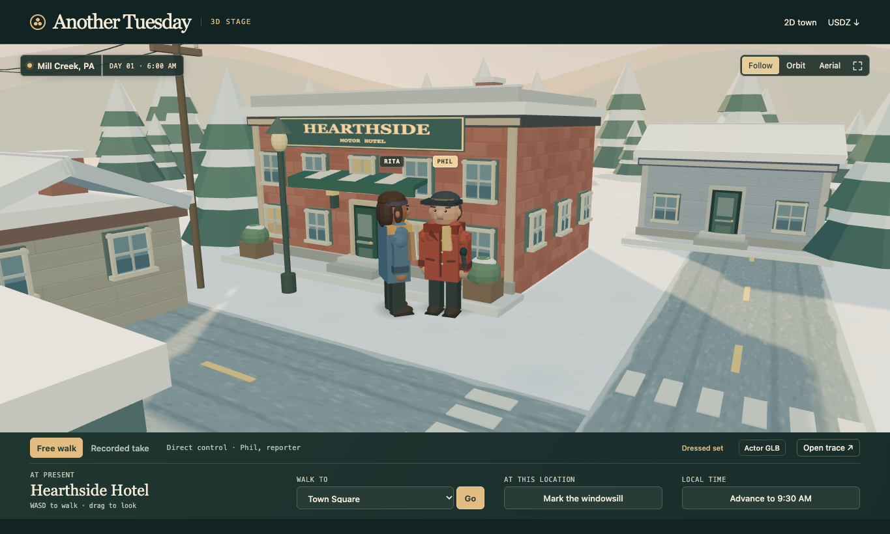

# Another Tuesday in 3D

[Open the interactive 3D town](viewer/index.html) · [Watch the 18-second browser motion proof](viewer/evidence/motion-proof.mp4) · [Walk the original 2D town](../visual/index.html)

The browser opens on Phil and Rita outside the Hearthside Hotel. Drag to look around, use WASD or the arrow keys to walk, and tap a building or select **Walk to**. Phones have a direction pad. **Follow**, **Orbit** and **Aerial** change the perspective camera. Scroll or pinch to zoom. The viewer loads from disk and makes zero external requests.

In **Free walk**, go to **Intercity Coach**, wait for 1 PM and board. The vehicle traverses the depot road and enters the separate Pittsburgh set. Use the payphone, stay until morning and watch Phil wake at the hotel. This mode gives the operator direct control and uses authored local interactions.

**Recorded take** plays logged model decisions. The first Phil recording contains his real coach trip, the call about helping his sister move a couch on Wednesday and the following hotel wake. Use **Follow** in the control deck to watch Rita or Larry go about that same day elsewhere. Direct witness links open [Phil leaving on the coach](viewer/index.html?take=film-transcript/seed-701.json&event=d02-t02-reporter&at=.58), [the Pittsburgh call](viewer/index.html?take=film-transcript/seed-701.json&event=d02-t03-reporter&at=.86), and [Larry filming in town](viewer/index.html?take=film-transcript/seed-701.json&event=d02-t01-reporter&at=.84&subject=camera). The 17.75-second motion proof uses four excerpts from a single actual 27B seed, silent captions and editorial shot timing. Its [edit ledger](viewer/evidence/motion-proof.json) records the source file hash, event IDs, actor, progress, frame range and wording. **Open trace** also accepts the independent [Punxsutawney badge take](../takes/badges/film/seed-721.json). On its fourth day at 7 PM, Rita selects Larry's camera tape on the portable switcher.



[Aerial town](viewer/evidence/aerial-town.png) · [The actual coach](viewer/evidence/recorded-coach.png) · [Pittsburgh phone call](viewer/evidence/recorded-pittsburgh.png) · [Rita's on-air choice](viewer/evidence/punxsutawney-switcher.png) · [Touch layout](viewer/evidence/mobile-town.png)

## The Rialto alternate performance

Select **Eight bars · Rialto 721-hypothesis** from **Recorded take** or open the [two-venue shot](viewer/rialto/index.html?shot=d01-evening-reporter&view=split&at=.70). Phil’s actual first-evening choice puts him alone at the local depot. Rita’s independent choice puts her on the ballroom floor. The [second-evening view](viewer/rialto/index.html?shot=d02-evening-producer&view=split&at=.90) frames a sleeping Phil in Pittsburgh alongside the regional station where Rita transmits Alma’s interview and Larry delivers a reel. The [next-dawn shot](viewer/rialto/index.html?shot=d03-afternoon-reporter&at=.90) shows the daughter’s world-authored reply at the Hearthside.

The separate Rialto WebGL stage reads nine beats from the finished 721-hypothesis run across six original, replaceable sets. The starting condition supplied Phil’s movie-ending theory. Stage geography, performance poses and timing within each source slot are editorial. The [26.5-second offline 3D cut](viewer/rialto/evidence/eight-bars-3d.mp4) has a [camera-by-camera source ledger](viewer/rialto/evidence/shot-ledger.json). Open the [operator notes and source IDs](viewer/rialto/README.md) or the [36-check browser verification](viewer/rialto/evidence/verification.json).

## A native stage and its interactive counterpart

[Open the animated USDZ stage](rehearsal/another-tuesday.usdz) or [watch the 24-second native 3D render](rehearsal/3d-blocking.mp4). The performance is day two through the next morning of the Phil/Rita/Larry seed-701 transcript. The proxy set shares its footprint and routes with the walkable isometric town. It includes two separate locations, an animated coach, three character rigs and a camera. Each cast member takes their own path. Source event IDs and the parent hash travel with the file. The animation timing and camera are editorial decisions.

The exporter evaluates the browser’s route and reset sampler at 24 frames per second, converts the map into a Y-up stage with metre units, then writes independent actor and camera tracks. The city is a second set 42 stage metres away. A new hotel morning repositions the actor at the next recorded cut. The head, coat, arms and legs are separately replaceable. The shapes are blocking geometry. Facial performance, garment deformation, buildings with working interiors and production lighting would need an art pass.

An artist can open the stage in a USD-capable editor, reference detailed character assets beneath the existing animated actor transforms, add their animation clips, place cameras, and render again from the original choice ledger. Time and placement changes can live in separate USD layers. The agent server never waits on this pipeline. [OpenUSD transform and animation example](https://openusd.org/release/tut_xforms.html)

From the repository root, run the exporter with Python and Node, then use the native USD tools on macOS.

```sh
python3 -B research/night/stage3d/export_stage.py research/night/takes/q27/film-transcript/seed-701.json --begin 4 --end 10 --out /tmp/tuesday-stage
cd /tmp/tuesday-stage
usdcat another-tuesday.usda -o another-tuesday.usdc
usdzip -a another-tuesday.usdc another-tuesday.usdz
usdchecker another-tuesday.usdz
usdrecord --camera /Stage/ReporterCamera --frames 0:575 --imageWidth 800 another-tuesday.usdz 'frame.####.###.png'
```

[Validation and frame counts](rehearsal/validation.json) · [Shot and source manifest](rehearsal/shot-manifest.json)

## Source geometry, motion and clearance

The [geometry builder](viewer/build_geometry.py) extracts 171 town primitives, 179 Pittsburgh primitives, three jointed rigs, the coach and native material colors directly from the checked-in USDA. Its output fingerprints both that stage and its source take. It handles the primitive subset emitted by this exporter. The browser uses the [same navigation map](../visual/world.js) and [receipt sampler](../visual/replay.js) as the 2D player. Native Y-up metres map to browser X/Y/Z directly. The 42-metre offset separates production sets. The camera cuts between those sets at the recorded transition and displays one environment at a time. That distance represents the layout in the stage file.

The **Dressed set** button toggles the browser art pass and original USD proxy geometry. The browser animates heading and gait and supplies its own interactive camera. The native USDZ carries the archived joint and camera tracks. The pass adds facade textures, wardrobe, ambient lighting, a terminal phone, set-specific props and a factual switcher readout. It also corrects two static buildings after a swept-coach test found intersections in the original blocking. A Mill Creek house moves 0.64 m south and a Pittsburgh café moves 2.10 m north. The terminal phone moves 0.32 m north to clear the arriving coach. The manual collision map uses the edited footprints, benches, lampposts and conifers. The actor and vehicle route coordinates remain the same. For the evening phone shot, the dressed composition releases the parked coach after the ride. The native blocking keeps the original parked position, whose hull overlaps the terminal actor anchor. No agent receipt specifies that the vehicle stays at the platform all evening.

The vehicle tracking camera tests candidate lenses against structures and trees across each straight leg, then holds the selected lens for that leg. This produces stable tracking shots around the depot turn. Building surfaces and distant pines share instanced geometry. The runtime caps pixel density and draws the visible set only. A WebGL failure automatically opens the local native MP4 and leaves the 2D town accessible. [WebGL-off fallback](viewer/evidence/fallback.png)

## Replace a performer at the venue

Download the original [field-coat GLB](viewer/assets/field-coat.glb), then use **Actor GLB** while following Phil. His coat, cap and boots switch immediately while the recording keeps the same playhead and world transform. The GLB carries two real animation clips, Idle and Walk. His own identity keeps the binding across recordings. **Reset mesh** restores the native rig. An artist can supply a self-contained binary glTF 2.0 model with embedded textures and buffers. The viewer accepts uncompressed meshes up to 64 MiB. For local production assets, names such as `Walk`, `Idle`, `Phone`, `Film`, `Mark` and `Broadcast` connect clips to the relevant recorded action. Export locomotion clips in place so the recorded world trajectory controls travel. The default fit height is 1.30 native stage metres. The API accepts an explicit height and heading when an artist needs them.

```js
await TuesdayStage3D.replaceActor(localGLBFile, {actor: "reporter", height: 1.30, yaw: 0});
TuesdayStage3D.resetActor("reporter");
```

The [field-coat exporter](viewer/build_actor_glb.py) builds that 11.8 KB example from the USD reporter's joint locations, with an alternate palette and two named motion clips. A failed upload leaves the previous performer in place, and slower old uploads cannot overwrite newer choices. [See the replacement inside the real take](viewer/evidence/field-coat-binding.png).

## Run and reproduce

The browser requires no package install, server, model endpoint or network connection. It ships a locally available classic Three.js 0.153 build so a `file://` page can run directly. Its [MIT license](viewer/vendor/THREE-LICENSE.txt) is included. For verification and export, install Python Playwright, a Chromium browser, and FFmpeg. The tests can use a local Chrome executable set in `CHROME_PATH`.

```sh
python3 -B research/night/stage3d/viewer/build_geometry.py
python3 -B research/night/stage3d/viewer/build_actor_glb.py
python3 -B research/night/stage3d/viewer/verify.py
python3 -B research/night/stage3d/viewer/render_proof.py
```

After `tuesdaystage3d:ready`, `window.TuesdayStage3D` exposes `loadTrace(raw)`, `seek(zeroBasedDecision, normalizedProgress)`, `follow(roleOrName)`, `setCamera("follow" | "orbit" | "aerial")`, `setCinematic(true, {captions:false})`, `setDressing(boolean)`, `projectWorld(x,y,z)`, `getState()` and `renderNow()`. The state includes logged subjects, actual Three.js rig positions, camera eye/target, visible native set, drawn coach screen bounds and source event ID. A deterministic seek lets an independent editor export reproducible frames at a chosen size. The included [proof renderer](viewer/render_proof.py) demonstrates that interface.

The [browser verification report](viewer/evidence/verification.json) covers the real desktop and emulated mobile entry points, native WebGL-off video decode, independent camera targets, playback, fractional seeks, tap navigation, coach clearance, the return to the hotel, and the real 27B switcher event. All 2,304 actor/vehicle translations across 576 published native frames matched within 0.000005 m. The largest discrepancy comes from five-decimal USDA text output. A 2,001-sample hull sweep found zero building intersections in the dressed set. A continuous segment test also cleared the conservative vehicle envelope against buildings, low stage props, lampposts, benches and conifers across every straight travel leg. The report includes wall-clock frame pacing on the tested machine. Hardware performance still needs measurement on physical phones and on the presentation laptop.

For higher-fidelity production, keep the native actor and venue paths stable, substitute detailed meshes and authored animation clips under those parents, and use the same cross-renderer position and clearance checks on every export. A whole new town stage with arbitrary meshes or USD composition arcs needs a standard USD-to-runtime conversion step. Actor GLBs already support ordinary meshes, skinning and animation clips through the bundled official loader. The native USDZ already supports a DCC-based art pass.
