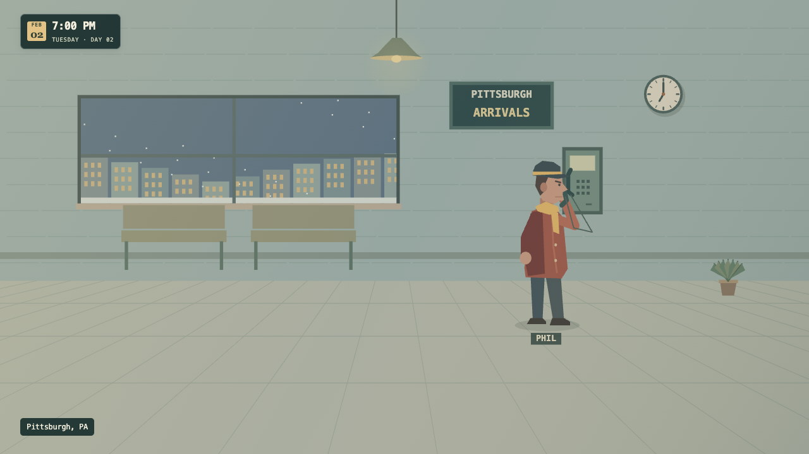

# Another Tuesday

Open [index.html](index.html) in a desktop or mobile browser. The page runs from disk, including the map, movement, sound, close-ups and five recordings. A model account or server is unnecessary for playback. The first recorded selection is the real 27B Phil/Rita/Larry take that reaches Pittsburgh.

## Walk the town

Use WASD, the arrow keys, the on-screen directional pad or a tap on the street. Clicking a landmark routes Phil to its entrance. The **Walk to** menu provides the same routes by name. **E** performs the first available local interaction. The right panel lists all current interactions and the decision log.

For an uninterrupted demonstration, mark the sill at the hotel, walk to **Intercity Coach**, wait for 1 PM and board. The coach drives out of town and into Pittsburgh. Use the terminal phone and choose **Stay until morning**. At 6 AM Phil wakes at the hotel and the pencil cross is gone. This free-walk scenario uses authored actions and NPC schedules. The **Recorded runs** tab plays model decisions.

## Show a recorded take

The built-in recordings preserve the original actors and receipts.

| Recording | Source | Moments to inspect |
|---|---|---|
| Phil · 27B · Pittsburgh | [Film cast, transcript memory, seed 701](../takes/q27/film-transcript/seed-701.json) | Day 2 at 1 PM Phil takes the coach. At 7 PM he uses the Pittsburgh payphone. Day 3 at 6 AM he wakes at the hotel. Day 4 at 9:30 AM he marks the windowsill. |
| Phil · 27B · diner | [Film cast, receipt memory, seed 701](../takes/q27/film-receipts/seed-701.json) | Day 3 at 9:30 AM and 1 PM Phil clears two racks. At 1 PM switch **Follow** to Larry to see what he films across town. |
| Ellis · 27B · neutral cast | [Neutral cast, receipt memory, seed 701](../takes/q27/neutral-receipts/seed-701.json) | Ellis goes to Pittsburgh on Day 2 while June and Cal remain in town. |
| Ellis · first rehearsal | [Original seed 511](../../repeating-town/runs/seed-511.json) | Ellis, Lou and Bea in the original small-model experiment. |
| Ellis · event memory | [Event-memory seed 511](../../repeating-town/event-memory-runs/seed-511.json) | The event-memory comparison, retaining the source's names and dialogue. |

Use **Close-up** to see the selected actor in the current location. Walking and coach travel use the street camera. **Overview** gives a wider view. The playback bar supports play/pause, stepping, scrubbing within each decision and 1×, 2× or 4× speed. **Open trace** accepts local JSON. **Sound on** enables the three-note morning alarm. The viewer can run alongside the [local live director](../live).

## What the picture establishes

The source supplies each actor's identity, decision, dialogue, origin, destination and action effect. The 27B format also supplies independent cast decisions and visible world state. The camera follows the selected actor, including a resident across town. The menu labels injected fixtures separately. In older files without independent per-slot resident positions, radio producer Lou and diner owner Bea use the original rehearsal schedule. The decision log shows their source dialogue when present.

The visualizer supplies streets, blocking, interpolation, sets, clothes, poses, signs, snowfall and shot timing. It renders each action's source and destination using one interval. The timestamps in the data have four slots per day. The specific path through an intersection, gesture timing and time spent on the bus are direction choices. A close-up frames the relevant part of the same location. V2 can show a portable switcher and the channel the world actually resolved at seven, including an empty return. The viewer provides no inner monologue or inferred emotional-state labels.



[Coach departure](evidence/q27-coach.png) · [Day 3 hotel reset](evidence/q27-hotel-return.png) · [Phil's pencil cross](evidence/q27-cross.png) · [Larry's independent festival shot](evidence/q27-festival-camera.png) · [Diner rack](evidence/q27-diner-plates.png) · [Mobile town](evidence/mobile-town.png) · [Mobile interior](evidence/mobile-interior.png)

## Cinematic and live interfaces

Wait for the `tuesdaytown:ready` window event or check for `window.TuesdayTown`. Calls synchronously return the current frame state. Here is the shot at the Pittsburgh phone in film-transcript seed 701.

```js
const town = window.TuesdayTown;
town.loadTrace(run);
town.setCinematic(true, {captions: false});
town.setCamera({actor: "reporter", framing: "close", scale: 1});
town.seek(7, 0.84);
```

Indices start at zero. `seek(index, progress)` pauses and accepts fractional progress from zero through one. Identical arguments yield the same pixels at a fixed viewport/browser. Between different browser engines and font stacks the text and rasterization can vary. Cinematic view retains the clock, date, location and names. The caption option suppresses the dialogue overlay for an independent sound/caption edit. The desktop `Escape` key returns to the regular layout. `setCamera` accepts an actor's exact name or role. Framing may be `"street"` or `"close"`. A close-up begins once the actor can be staged at that location. `scale` changes the exterior follow zoom. `getState()` reports the protagonist and position, all subjects, the displayed scene, `heroScene`, `cameraActor`, `cameraPlace`, `framing`, projected world facts and event ID. `renderNow()` refreshes the frame after a size change.

On an outbound coach event the first 32% walks to the depot, 32–38% boards, 38–68% drives through town, 68–89% enters Pittsburgh, and the final 11% disembarks. On subsequent dawns the first 10% belongs to the previous evening, 10–19% fades up on the hotel, and 19–25% holds the morning alarm. The new decision occupies the remaining 75%. These timings are visual interpolation. The physical facts change at 68% of the action's own interval.

Start a live epoch by loading its first materialized snapshot. Call `play()` to follow the first slot immediately. When the latest slot finishes the player waits there for new committed decisions. A repeated `play()` preserves that position.

```js
town.loadTrace(firstSnapshot);
town.play();
town.appendEvents(nextRows, {offset: numberOfPriorRows, follow: true});
```

The caller owns the epoch ID and begins a new epoch with `loadTrace`. An offset is the zero-based index of the first row in the delivered batch. A completely or partially overlapping retransmission is idempotent if the normalized rendered history agrees. A gap, a changed historical decision, a reused ID or an out-of-order suffix rejects the batch atomically. The delta path validates incoming rows and the overlap only. `appendOrRefresh(snapshot,{follow:true})` is available to small snapshot-only hosts and validates the entire committed prefix. User seeks and playback controls can pause live playback. To rearm follow, call `play()`.

### Input and asset boundaries

A run has a protagonist header or first-row actor and a nonempty `events` array. Every main row carries a `day`, `clock`, `origin`, `place` and `decision.action`. Actor names, IDs, words, effect and optional per-slot `cast` rows round out the playback. The optional top-level `municipality` supplies the town name on the HUD. Historical recordings default to Mill Creek. The six recognized places are `inn`, `diner`, `square`, `studio`, `depot` and `Pittsburgh`. Four daily clocks are 6:00 am, 9:30 am, 1:00 pm and 7:00 pm. A missing historical ID is synthesized from day, slot and role for navigation. Real 27B IDs are retained. The local import control accepts files up to 32 MiB and 50,000 slots. The normalization layer accepts either raw `world_before` / `world_after` or the compact streaming `visible_before` / `visible_after` and optional `bulletin`.

| File | Responsibility |
|---|---|
| [world.js](world.js) | Metric map, landmarks, obstacles, projection, shared A* route search and segment collision checks |
| [replay.js](replay.js) | Receipt parsing, privacy-filtered visible props, named actors and deterministic scene sampling |
| [art.js](art.js) | Exterior lighting, cached static sets, depth sorting, costumes, coach and labels |
| [interiors.js](interiors.js) | Six location sets, role equipment, action poses and data-driven practical props |
| [app.js](app.js) | Movement, UI controls, trace selection, render loop, cinematic camera and incremental playback |
| [build-traces.py](build-traces.py) | Rebuilds the offline archive from the real rehearsal logs |
| [verify.py](verify.py) | Headless Chromium end-to-end and performance checks |

A richer renderer can consume the same receipts and normalized transforms. Preserve the stable role/actor and venue IDs as asset bindings, keep cut timing in the director, and swap each venue, role costume or pose independently. The separate [OpenUSD stage](../stage3d) provides a 3D interchange path. To go beyond the in-memory cap, use indexed immutable time segments, order committed slots by epoch and offset, retain one visible snapshot per segment boundary and fetch adjacent segments. The DOM log renders at most eleven recorded decisions, A* routes are cached, and static exterior art is cached independently from moving people. Fixed-seed snow and event-derived time allow offline frame export.

## Verification

The [browser results](evidence/verification.json) record the Chrome version, successful assertions, measured timings and frame hash. Tests cover manual escape and dawn, desktop fullscreen, portrait controls, camera selection, both legacy imports, actual 27B traces, independent residents, rejected input, deterministic repeated seeks, 75 navigable anchor pairs, compact props and overlapping live segments. The base run uses a small marked fixture for the V2 switcher. Set `V2_TRACE` to check an additional real or fixture take. The optional fixture check in the saved report used an injected V2 trace.

From the project root, run the following with Python, Playwright and Chrome or Chromium available. `CHROME_PATH` can specify the browser executable. The app itself has zero runtime package dependencies.

```sh
python3 research/night/visual/build-traces.py
python3 research/night/visual/verify.py
```

A separate 1280×720 headless playback sample measures elapsed wall time, display callbacks, progressing playheads per second and the 95th-percentile gap for the real coach and phone scenes. Those rates apply to this machine and browser. The random-access benchmark materializes a synthetic 20,000-decision track in the page, then performs 100 random-access seeks on one stationary location. It measures main-thread normalization, draw command submission and DOM updates after scene caches are warm. GPU compositing, screenshot encoding, file parsing, full-scale animated crowd rendering and model latency require separate benchmarks. No external web requests occurred during the offline browser run.

## Model-selected coordinates

The separate [On foot navigation pilot](../free-walk/README.md) lets you watch three local Qwen3 0.6B roles actually choose their own map coordinates. It includes matched door controls, obstacle correction, multi-person collision reservations and a native USDZ from a real take. [Play the off-landmark walk](../free-walk/index.html?condition=free&seed=953).
